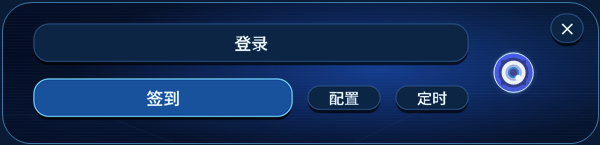
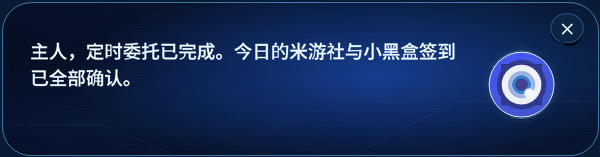
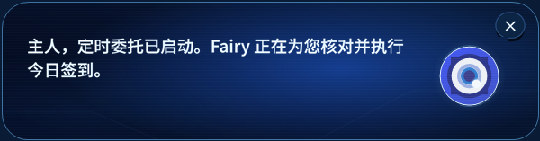
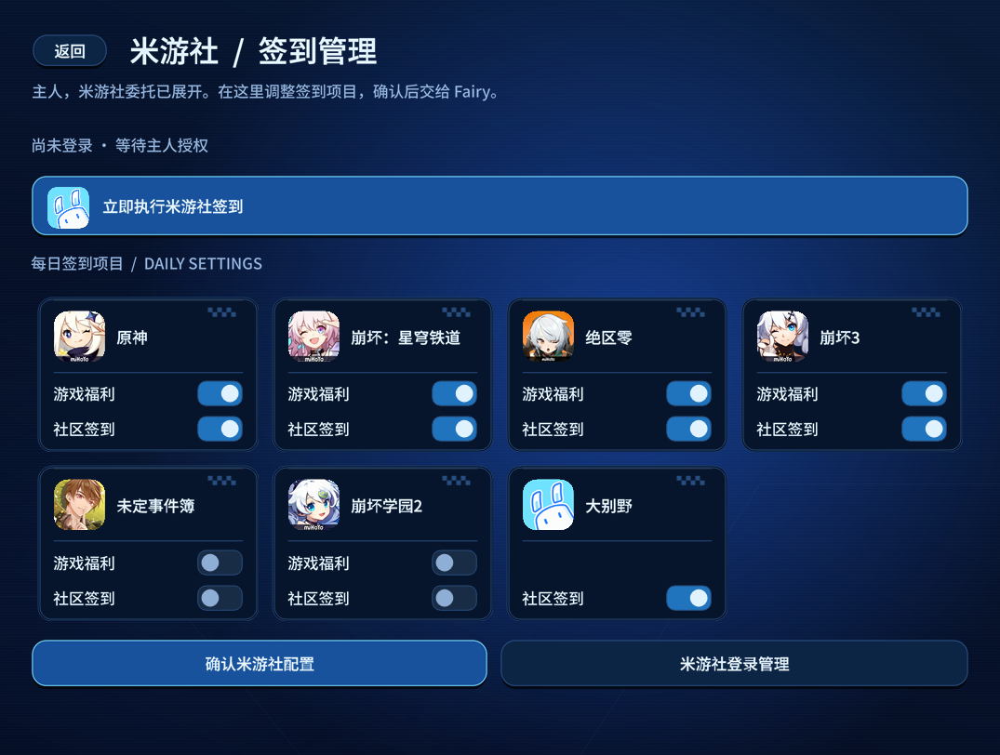
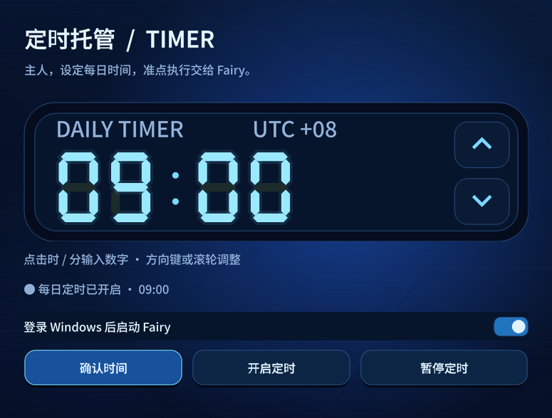
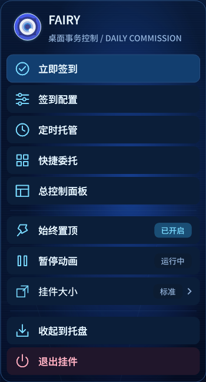
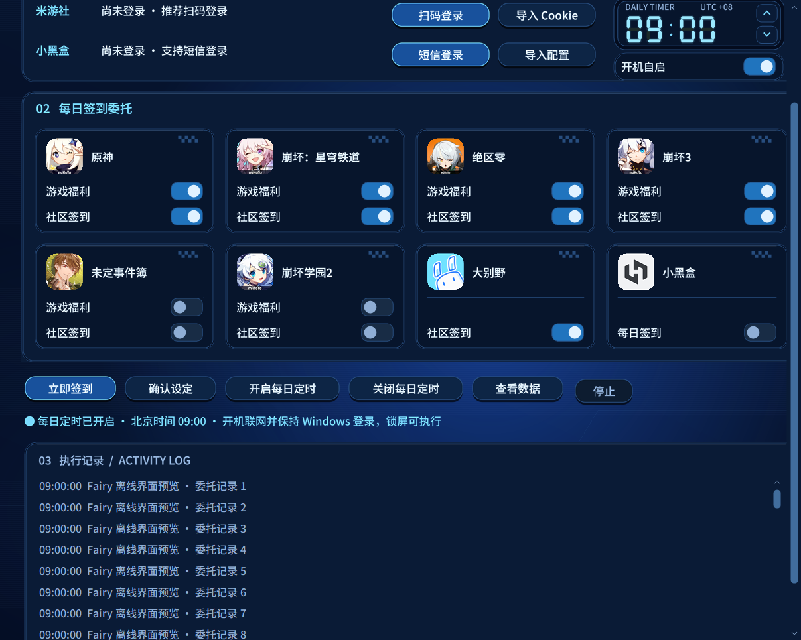

# Fairy Daily

Fairy 桌面挂件驱动的米游社、小黑盒每日签到工具。使用 C# / WinForms 与 .NET Framework 4.8，面向 Windows 10/11，无需 Python、Node.js 或模型 API Key。

[下载 Windows 发布包](https://github.com/Areacho/Fairy-Daily/releases/latest/download/MiyouDaily-Windows.zip) · [发布记录与校验文件](https://github.com/Areacho/Fairy-Daily/releases)

## 使用

1. 完整解压 `MiyouDaily-Windows.zip`，运行 `MiyouDaily.exe`。保留同目录的配置、WebView2 DLL 与 `runtimes` 文件夹。
2. 单击桌面眼睛，选择“登录”，在下一层选择米游社或小黑盒。登录后第一行变为灰色“已登录”，第二行“签到”始终可见。
3. 点击“签到”直接执行已经确认的全部签到项目。需要修改时，点击签到旁边较小的“配置”，再选择平台。米游社管理页直接展示所有游戏福利、社区开关，小黑盒管理页提供每日签到开关；修改后确认保存。
4. 手动、分平台和定时任务完成后，都由 Fairy 对话框显示结果。需要单独执行某个平台时，可在配置页使用该平台的“立即执行”。日志可从气泡中的小眼睛进入总控制面板查看。
5. 从较小的“定时”按钮进入大数码钟页面，确认北京时间并开启每日定时。默认时间为 09:00，可同时开启登录 Windows 后启动挂件，以及“全部签到完成后自动退出挂件”。自动退出默认关闭，开关调整后即时保存。

电脑需要开机、联网并保持 Windows 登录；锁屏可以执行。关机、睡眠或注销时无法实时签到，恢复后按任务计划补跑当天任务，不追回往日奖励，也不会主动唤醒电脑。

## 界面与交互

- 深蓝背景、冷蓝光晕、扫描线和统一字体，面板和右键菜单标题只保留 FAIRY。总控制面板完全不透明，分板块弹窗与气泡约为 80% 不透明度。
- 页面与日志的滚动条使用深蓝轨道和细蓝滑块，悬停时提亮，保留原生滚轮、拖动、键盘操作与 DPI 缩放。
- 登录、签到分成两行；签到直接执行，旁边的配置与定时采用较小的辅助入口。米游社与小黑盒均使用平台图标。
- 页面按打开来源逐级返回，从签到管理进入登录管理后，返回仍回到对应平台。
- 总面板、分板块页面、扫码窗口与登录弹窗统一从所在屏幕工作区中央打开，重新打开时恢复居中；页面切换改变尺寸时保留窗口中心。挂件位置与旁边的气泡单独保留。
- 手动关闭页面或登录弹窗时同步收起气泡，关闭后的取消结果不再次弹出提示。
- 通知气泡不带底部操作按钮。单击挂件显示快捷入口；双击挂件不打开总面板；气泡里的小眼睛保留总面板入口。
- 定时执行时先显示开始气泡，再显示完成或失败结果；挂件未运行时自动唤起。快速结束的任务也会短暂保留开始提示。气泡固定在挂件旁，只随挂件移动，不随页面窗口或鼠标位置改变；屏幕边缘空间不足时才换侧，提示展开时保持位置稳定。显示气泡时不激活窗口、不移动或捕获鼠标，保留正在操作的应用焦点。
- 所有气泡独立置顶，不受挂件“始终置顶”开关影响。复用气泡或打开新的登录页面时保持在本程序页面上方，同时保留原有应用的焦点；关闭气泡后不再提升层级。
- 完成结果通过置顶的非模态对话框显示；锁屏期间保留未读结果，恢复桌面后显示。已显示的结果不因重启重复弹出，无新委托的同日重复检查去重；实际重试会显示该次执行的结果，手动点击仍即时反馈。
- 挂件退出时眼睛收束为白色横向柔光，再缩成中心光点消失；启动时反向展开，不加入雪花和噪点。手动退出和签到后的自动退出均使用该效果，暂停动画只暂停待机运动。页面切换先完成新内容排版再显示，统一合成绘制，减少空白帧与滚动条闪白。
- 自动退出开启后，手动或定时签到确认当天全部已选项目完成时，先显示结果气泡，8 秒后退出挂件。点击挂件、打开菜单/页面或关闭气泡可取消本次退出。签到失败、未全部完成或仍有任务运行时不会退出；锁屏时推迟到恢复桌面。退出挂件后每日定时继续保留。
- 拖动眼睛移动挂件。右键菜单采用紧凑的深蓝圆角布局，占用面积约为原来一半，保留图标和状态标识；提供立即签到、配置、定时与总控制面板入口，以及置顶、暂停动画、大小、收起到托盘和退出。选择操作、按 Esc 或切换到外部窗口可收起菜单和子菜单；双击托盘图标恢复挂件。

以下预览使用隔离的空白账号数据，不执行登录或签到。















## 2K / 4K 与高 DPI

按显示器 DPI 缩放窗口、文字、图标和操作区域，支持跨屏后重新排布。窗口尺寸受当前屏幕工作区约束，极高缩放时使用滚动区域保留内容，避免确认按钮或日志落在屏幕外。

| 工作区测试 | 覆盖的 Windows 缩放 |
| --- | --- |
| 2560 × 1440（2K） | 100%、125%、150%、175%、200%、250%、300% |
| 3840 × 2160（4K） | 100%、125%、150%、175%、200%、250%、300% |

验证包含虚拟工作区、模拟框架 DPI、跨 DPI 往返布局、未确认配置保留，以及 96～288 DPI 的原生像素文字与按钮绘制。4K 工作区通过模拟回归验证，不表示已在全部 4K 物理显示器上实测。测试报告生成到 `build/high-dpi-report.json`。

程序使用 [Microsoft 文档中的 .NET Framework PerMonitorV2 配置](https://learn.microsoft.com/en-us/dotnet/desktop/winforms/high-dpi-support-in-windows-forms?view=netframeworkdesktop-4.8)。预览工具也声明 .NET Framework 4.8，使用同一套 DPI 设置。

## 签到与登录

米游社支持原神、崩坏：星穹铁道、绝区零、崩坏3、未定事件簿、崩坏学园2的国服游戏福利，以及对应社区和大别野的每日签到。游戏福利与社区开关分别配置。扫码需要米游社 App 在手机上确认，也可导入已有 Cookie；社区签到需要 stuid/stoken，v2 stoken 还需要 mid。

小黑盒支持短信验证码登录，也可导入 [heybox-daily](https://github.com/Cansiny0320/heybox-daily) 的 `private/config.json`。配置需要 session、device、app，普通网页 Cookie 不能替代完整 App 登录信息。当前协议适配 App 1.3.398 / build 1142 / shader 14。短信登录需要 Microsoft Edge WebView2 Runtime；每日签到直接通过 C# 请求接口，不启动浏览器。

执行前检查账号、北京时间日期与分项目记录，已完成的项目当天跳过。没有本机记录时先查询服务端，提交后再次确认。单项目失败不阻止其他项目，手动可以重试；每日任务对未完成项目有限重试。验证码、过期或首次绑定需要在官方 App 中完成处理。

## 本机数据

数据保存在 `%USERPROFILE%\.miyou-daily`，总面板的“查看数据”可打开目录。凭证使用 Windows DPAPI 当前用户范围加密，与源码和发布包分开保存。

| 文件 | 用途 |
| --- | --- |
| `config.json` | 签到选择、时间与加密后的平台凭证 |
| `state.json` | 当天分项目进度、失败与重试记录 |
| `logs/` | 脱敏运行日志 |
| `widget.json` | 挂件位置、大小、置顶与动画偏好 |
| `speech.json`、`speech-progress.json`、`speech-receipts.json` | 最新结果、配对的执行提示与已显示记录，用于补显示和去重 |
| `app/` | 定时与自启使用的固定程序副本 |
| `task.xml` | 当前用户 Windows 任务计划定义 |

已安装的 Windows 签到任务可在退出挂件后继续运行；如需停止，在定时页暂停。修改配置后会同步已安装的任务。卸载前可先关闭每日定时与自启，再清理程序和本机数据。

## 构建与验证

使用 Windows 自带的 .NET Framework 编译器，无需 .NET SDK。首次构建从 NuGet 获取固定版本 QRCoder 1.8.1、WebView2 1.0.4314.35，并校验 SHA-256；之后使用本地缓存。

```powershell
# 编译并运行离线测试，不登录、不发送短信、不执行真实签到
.\build.cmd -Test

# 已构建后生成 Windows 发布包和 SHA256SUMS.txt
powershell.exe -NoProfile -ExecutionPolicy Bypass -File .\tools\package.ps1 -SkipBuild

# 或重新构建并打包
powershell.exe -NoProfile -ExecutionPolicy Bypass -File .\tools\package.ps1 -Test

# 解压发布包后的离线组件自检
.\MiyouDaily.exe --self-check
```

发布包为 `dist/MiyouDaily-Windows.zip`，校验文件为 `dist/SHA256SUMS.txt`。无界面入口是 `MiyouDaily.exe --run`；计划任务使用 `--run --scheduled`。接口参数集中在 `src/Core.cs`，小黑盒协议实现位于 `src/HeyboxApi.cs` 与 `src/HeyboxSignature.cs`。

离线测试覆盖认证请求构造、加密、账号隔离、服务端确认、重复跳过、取消、失败隔离、通知去重、导航、字体、DPI、定时与自启。测试使用合成账号；真实登录和奖励到账以本机日志为准。GitHub Actions 在 Windows 上运行同一套构建、测试和打包检查。

## 参考与第三方组件

- Fairy 视觉参考与原生适配：[Chengzhibense/Fairy-DSH](https://github.com/Chengzhibense/Fairy-DSH)，见 `FAIRY-NOTICE.txt`、`FAIRY-LICENSE.txt`。
- 小黑盒协议参考：[Cansiny0320/heybox-daily](https://github.com/Cansiny0320/heybox-daily)，参考提交 b169bf43d7fb77183856b35c39074ff58c52565c，见 `HEYBOX-LICENSE.txt`。
- 米游社接口参考：[Womsxd/MihoyoBBSTools](https://github.com/Womsxd/MihoyoBBSTools)、[Marchen-orz/MiyoQian](https://github.com/Marchen-orz/MiyoQian)。
- QRCoder、WebView2 与 Noto Sans SC 的声明见 `THIRD-PARTY-NOTICES.txt` 及随包附带的许可文件。内嵌 Miyou UI 字体由 Noto Sans SC 的 500/900 字重生成，不向系统安装字体。
- 游戏、平台图标来自提供的素材，运行时从程序资源加载；资源说明见 `assets/README.md`。

